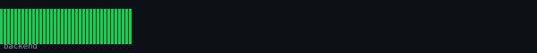
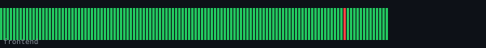

# Cura — Full-Stack Care Home Management Platform

UK's #1 care home management platform, rebuilt on steroids.

[](https://github.com/R3sourc3s/Cura/actions/workflows/test.yml)
[](https://github.com/R3sourc3s/Cura/actions/workflows/docker.yml)
[](.github/workflows/test.yml)
[](.github/workflows/test.yml)

Coverage badges are generated by CI on every push to `main` (see `.github/workflows/test.yml`) and committed to `badges/`. Rendered locally (`scripts/render_badge.py`) and linked by relative path rather than shields.io — **this repo is private**, and shields.io's badge service fetches from its own server with no GitHub auth, so it can't reach private raw content at all (that's also why they need relative paths here, not `raw.githubusercontent.com` — GitHub serves relative-path images through the viewer's own authenticated session instead of an anonymous external fetch).

## Live

| Service  | URL |
|----------|-----|
| Frontend | https://frontend-production-dbcf.up.railway.app |
| API      | https://backend-production-cfcf.up.railway.app |

[](.github/workflows/uptime.yml)
[](.github/workflows/uptime.yml)




Pings `/api/health/` and `/api/health` every 10 minutes (`.github/workflows/uptime.yml`) and pushes the result straight to these files — same self-contained, no-third-party-account pattern as the coverage badges, not a hosted uptime-monitor service. Each bar in the graph is one check (green = up, red = down); uptime % is over the last 48 hours of history.

## Architecture

```
cura/
├── src/          ← Next.js 16 app (marketing site + /dashboard, single app, one port)
├── backend/      ← Django REST Framework API
└── docker-compose.yml
```

| Service    | URL (local dev)                  | Stack                               |
|------------|-----------------------------------|-------------------------------------|
| Frontend   | http://localhost:3000            | Next.js 16, TypeScript, Tailwind    |
| API        | http://localhost:8000            | Django 5, DRF, SimpleJWT            |
| API Docs   | http://localhost:8000/api/docs/  | drf-spectacular / Swagger           |
| Admin      | http://localhost:8000/admin/     | Django Admin                        |
| Health     | http://localhost:8000/api/health/ · http://localhost:3000/api/health | DB/Redis liveness checks, used by Docker healthchecks |

Marketing pages and the authenticated dashboard (`/dashboard/*`) are routes within the same Next.js app — there's no separate frontend/marketing split or second port; that's a correction to what this README said before.

## Quick Start (Docker)

```bash
cp backend/.env.example backend/.env
cp .env.example .env
# Add ANTHROPIC_API_KEY to backend/.env, OPENAI_API_KEY to the root .env

docker compose up --build
docker compose exec backend python manage.py createsuperuser
```

## Local Development

### Backend
```bash
cd backend
python -m venv .venv && source .venv/bin/activate
pip install -r requirements-dev.txt   # requirements.txt + test/coverage/audit tooling
cp .env.example .env
python manage.py migrate
python manage.py createsuperuser
python manage.py runserver
```

### Frontend
```bash
npm install && npm run dev   # from repo root → http://localhost:3000 (marketing + /dashboard)
```

## Testing & Coverage

```bash
# Backend
cd backend && coverage run manage.py test && coverage report

# Frontend
npm run test             # single run
npm run test:watch       # watch mode
npm run test:coverage    # with coverage report (coverage/index.html)
```

CI runs both on every push/PR (`.github/workflows/test.yml`) and publishes the coverage badges above on merges to `main`.

## API Endpoints (`/api/v1/`)

| Resource          | Path                                              |
|-------------------|---------------------------------------------------|
| Auth              | `/auth/login/` `/auth/refresh/` `/auth/me/`       |
| Residents         | `/residents/`                                     |
| Medications / MAR | `/medications/` `/medications/mar/` `/medications/low_stock/` |
| Care Plans        | `/care-plans/` `/care-plans/{id}/generate-summary/` |
| Staff             | `/staff/shifts/` `/staff/leave/` `/staff/training/` |
| Compliance        | `/compliance/audits/` `/compliance/policies/`     |
| AI                | `/ai/chat/` `/ai/compliance-gap-report/` `/ai/residents/{id}/risk-score/` |

## AI Features (Anthropic Claude)

- **Chat** — conversational assistant with full resident context
- **Care plan summaries** — plain-English handover briefs via `claude-sonnet-4-6`
- **Risk scoring** — composite 0–100 resident risk score via `claude-haiku-4-5-20251001`
- **Compliance gap report** — CQC-mapped gaps and improvement actions

## Roles

| Role      | Access                                    |
|-----------|-------------------------------------------|
| `admin`   | Full platform access                      |
| `manager` | Residents, care plans, compliance         |
| `nurse`   | Medications, MAR, care plans              |
| `carer`   | Residents, tasks, MAR (own shifts only)   |
| `hr`      | Staff, shifts, leave, training            |

## Key Environment Variables

`backend/.env`: `SECRET_KEY`, `DATABASE_URL`, `REDIS_URL`, `ANTHROPIC_API_KEY`, `CORS_ALLOWED_ORIGINS`

`.env` (repo root, frontend): `OPENAI_API_KEY`, `NEXT_PUBLIC_SENTRY_DSN`
